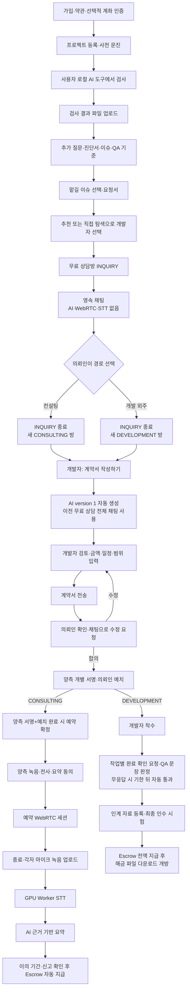
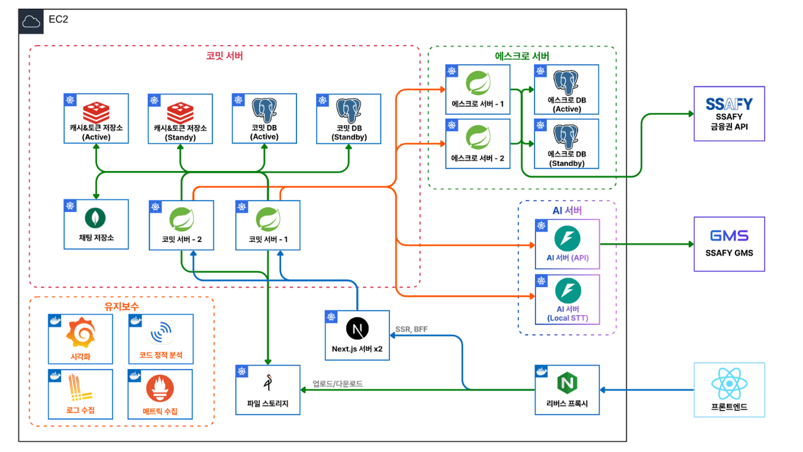

# 코밋 (Komit)

> 바이브 코딩으로 만든 것은 있는데, 어디서 막혔는지 모를 때

**팀 우주정복 · 팀코드 A201** · SSAFY 특화 프로젝트 (핀테크)

---

## 1. 서비스 소개

바이브 코딩으로 앱을 만든 비개발자는 배포·DB 연결·도메인 단계에서 막혀 개발자를 찾습니다. 그런데
**무엇을 어디까지 하기로 했는지, 언제 대금을 줘야 하는지**가 정해지지 않아 거래가 성사되지 않거나
분쟁으로 끝납니다. 의뢰인은 요청서를 못 쓰고 결과물을 판단하지 못한 채 선불이 불안하고, 개발자는
범위 밖 작업이 밀려들고 승인이 미뤄지면 대금을 못 받습니다.

코밋은 이 합의를 상담 단계에서 **문장으로 못 박고, 그 문장을 그대로 대금 지급 조건으로 씁니다.**

| 쓰는 사람 | 하는 일 |
| --- | --- |
| **의뢰인** | 내 프로젝트를 점검하고, 맡길 문제를 골라 요청서로 만들고, 결과를 확인 문장으로 판단합니다 |
| **개발자** | 요청서를 읽고 상담·컨설팅으로 범위를 좁힌 뒤 계약을 쓰고, 작업 단위로 대금을 받습니다 |

## 2. 전체 사용자 흐름



## 3. 주요 기능

1. **사전점검** — AI 코딩 도구로 내 개발 환경에서 프로젝트를 점검하고 결과 파일만 올립니다. 코밋이
   결함과 확인 기준으로 정리합니다
2. **요청서** — 직접 고칠 문제와 맡길 문제를 고르면 고른 범위만 요청서와 계약으로 이어집니다
3. **매칭과 상담** — 개발자를 추천받아 무료 상담방을 엽니다. 실시간 채팅으로 이야기하고, 유료
   컨설팅은 브라우저끼리 직접 연결하는 화상 세션으로 합니다. 세션 대화는 전사해 요약합니다
4. **계약** — 상담 내용을 AI 가 초안으로 정리하고 개발자가 검수해 계약서로 만듭니다. 개발자는 자기가
   받은 요청서를 방에서 읽을 수 있습니다
5. **확인 문장으로 판단** — 작업마다 확인 문장이 붙습니다. 의뢰인은 그 문장으로 통과 여부를 정합니다.
   일부만 통과시키면 작업이 개발자에게 돌아가고, 답이 없으면 기한 뒤 자동 통과됩니다
6. **인계와 최종 인수 시험** — 일반 작업이 모두 통과하면 개발자가 인수시험용 URL·파일과 지급 후 해금
   파일을 등록합니다. 의뢰인이 전체 결과를 확인해 통과시키는 것이 최종 인수 시험 통과입니다
7. **일괄 지급과 해금** — 전 작업이 통과 확정된 뒤 계약 대금을 한 번에 지급합니다. 지급액과 수수료가
   모두 확정되면 계약이 완료되고 의뢰인이 해금 파일을 받습니다
8. **에스크로** — 예치·정산·이중부기 원장·대사. SSAFY 금융망과 연동합니다

## 4. 기술 스택

| 구분 | 기술 |
| --- | --- |
| Frontend | Next.js 16 · React 19 · TypeScript 5 |
| Backend | Spring Boot 4.1 · Java 21 · Gradle |
| AI | FastAPI · SSAFY GMS (OpenAI 호환) · faster-whisper (음성 전사) |
| Realtime | WebSocket · Redis Pub/Sub (중계) · WebRTC (화상, coturn 으로 중계) |
| Database | PostgreSQL · Redis · MongoDB (채팅) |
| Storage | MinIO (S3 호환) |
| Test | JUnit 5 · Testcontainers · Vitest · Playwright |
| Infra | K3s · Docker · GitLab CI/CD · Nginx |

## 5. 시스템 구성



서버는 EC2 한 대 위의 K3s 에 올라갑니다.

| 묶음 | 구성 |
| --- | --- |
| **코밋 서버** | Spring Boot ×2 · PostgreSQL(Active/Standby) · Redis(Active/Standby) · MongoDB |
| **에스크로 서버** | Spring Boot ×2 · PostgreSQL(Active/Standby). SSAFY 금융망 API 호출 |
| **AI 서버** | FastAPI. SSAFY GMS 호출. 음성 전사는 서버 안에서 처리 |
| **프론트엔드** | Next.js ×2 (SSR·BFF). 앞에 리버스 프록시 |
| **파일 저장소** | MinIO. 업로드·다운로드는 미리 서명한 주소로 브라우저가 직접 |
| **관측** | 로그·메트릭 수집과 시각화, 코드 정적 분석 |

**자금 처리는 에스크로에만 둡니다.** 코밋 서버는 에스크로를 내부 API 로 부릅니다. ([`AGENTS.md`](AGENTS.md))

## 6. 저장소 구조

| 경로 | 파트·스택 | 책임 | 자체 규칙 |
| --- | --- | --- | --- |
| `fe/` | `fe` · Next.js | 플랫폼 웹, SSR·BFF, WebRTC·브라우저 녹음 | `fe/AGENTS.md` |
| `service/` | `be-api` · Spring Boot | 회원·진단·요청서·매칭·방·채팅·계약·컨설팅·리뷰·파일 메타데이터 | `service/AGENTS.md` |
| `escrow/` | `be-escrow` · Spring Boot | 계좌·예치·지급·환불·복식부기 원장·대사·금융 API 연동 | — |
| `ai/worker/` | `ai` · FastAPI | 계약 초안·QA 후보·컨설팅 요약 생성과 출력 검증 | `ai/AGENTS.md` |
| `ai/komit-scan/` | `ai` · Claude 플러그인 | 사용자 컴퓨터에서 실행하는 사전점검 절차와 결과 규격 | `ai/AGENTS.md` |
| `mock/` | Python · FastAPI | FE 개발과 API 계약 검증용 대역 서버 | `mock/AGENTS.md` |
| `deploy/` | `infra` · K3s·Docker Compose | 로컬 실행, 이미지 배포, Kubernetes 인프라 | — |
| `docs/` | `common` · Markdown | 기획·정책·기능명세·QA·컨벤션·인계 문서 | — |
| `demo/` | Next.js | 사전점검 품질 검증용 결함 예시 프로젝트 | — |
| `고은찬/`, `박다빈/`, `박연수/`, `이정복/`, `이해준/`, `전지웅/` | 개인 작업 공간 | 개인 실험·작업 기록. 공용 문서 원본을 두지 않음 | — |

- `service/`와 `escrow/`는 서로 다른 Gradle 프로젝트이며 자금 처리는 `escrow/`에만 둡니다. (`R-PAY-05`)
- 하위 디렉터리에 `AGENTS.md`가 있으면 해당 파트 작업에서는 최상단 규칙보다 우선합니다.
- `mock/`의 성공 응답은 실제 Service 구현 완료를 뜻하지 않습니다.
- `demo/`는 의도적으로 결함을 심은 검사 대상이므로 배포하지 않습니다. 실행 방법은 [`demo/RUNBOOK.md`](demo/RUNBOOK.md)에 있습니다.
- 개인 작업 공간의 문서는 공식 기준이 아닙니다. 공용 기준은 `docs/`와 최상단 문서를 사용합니다.

## 7. 시작하기

### 사전 준비

JDK 21 · Node.js · Python 3.11 이상 · Docker

### 환경 변수

각 모듈의 `.env.example` 을 복사해 씁니다. 값은 팀 내부에서 받습니다.

```bash
cp service/.env.example service/.env
cp ai/worker/.env.example ai/worker/.env
```

`ai/worker/.env` 의 `GMS_API_KEY` 는 저장소에 올리지 않습니다.

### 한 번에 띄우기

```bash
docker compose -f deploy/local/docker-compose.yml up -d
```

| 서비스 | 주소 |
| --- | --- |
| 프론트엔드 | http://localhost:3000 |
| 코밋 서버 | http://localhost:8080 |
| 에스크로 서버 | http://localhost:8081 |
| MinIO 콘솔 | http://localhost:9001 |

### 모듈만 따로 띄우기

```bash
# 프론트엔드
cd fe && npm install && npm run dev

# 코밋 서버 / 에스크로 서버
cd service && ./gradlew bootRun
cd escrow && ./gradlew bootRun

# AI 서버 (8000)
python -m uvicorn app:app --port 8000 --app-dir ai/worker

# 목 서버 (8080) — 코밋 서버와 포트가 같으니 함께 띄우지 않습니다
cd mock && uvicorn app.main:app --reload --port 8080
```

목 서버를 띄우면 API 명세를 브라우저에서 볼 수 있습니다.

- 코밋 — http://localhost:8080/service/docs
- 에스크로 — http://localhost:8080/escrow/docs

## 8. 테스트

```bash
cd service && ./gradlew test          # 서버. Testcontainers 라 Docker 가 떠 있어야 합니다
cd escrow && ./gradlew test
cd fe && npm test                     # Vitest
cd fe && npm run test:e2e             # Playwright
python -m unittest discover -s ai/worker/tests
```

MR 을 올리면 파이프라인이 모듈별 테스트와 컨벤션 검사를 돌립니다. 자세한 것은
[`docs/git_guide.md`](docs/git_guide.md) 에 있습니다.

## 9. 배포

이미지는 CI 가 구워 Docker Hub 에 올리고, 서버는 그것을 받아 씁니다. 서버에는 소스를 두지 않습니다.
K3s 구성과 필요한 CI/CD 변수는 [`deploy/k3s/README.md`](deploy/k3s/README.md) 에 있습니다.

## 10. 문서

### 제품·정책·품질

| 문서 | 역할 |
| --- | --- |
| [`docs/proposal.md`](docs/proposal.md) | 기획서. 무엇을 왜 만드는가, 사용자와 흐름 |
| [`docs/RULES.md`](docs/RULES.md) | 규칙서. 기한·금액·횟수 같은 정책 값과 불변식 |
| [`docs/FUNCTIONAL_SPEC.md`](docs/FUNCTIONAL_SPEC.md) | 기능명세서. 사용자 기능과 실제 구현 경계 |
| [`docs/QA.md`](docs/QA.md) | QA 문서. 전체 흐름·도메인별 검증과 출시 판정 |
| [`AGENTS.md`](AGENTS.md) | 저장소 전체 작업 원칙과 문서 지도 |
| [`docs/git_guide.md`](docs/git_guide.md) | 브랜치·커밋·MR 규칙 |

### 개발 규칙·인계

| 문서 | 역할 |
| --- | --- |
| [`docs/BACKEND_CONVENTIONS.md`](docs/BACKEND_CONVENTIONS.md) | 백엔드 코드 컨벤션 |
| [`docs/FRONTEND_CONVENTIONS.md`](docs/FRONTEND_CONVENTIONS.md) | 프론트엔드 코드 컨벤션 |
| [`docs/FRONTEND_COMPONENTS.md`](docs/FRONTEND_COMPONENTS.md) | 공용 UI 컴포넌트 |
| [`docs/jwt-samples.md`](docs/jwt-samples.md) | JWT 인증 요청 예시 |
| [`docs/mongodb-handoff.md`](docs/mongodb-handoff.md) | MongoDB 채팅 저장소 운영·인계 내용 |
| [`deploy/README.md`](deploy/README.md) | 배포 구조와 실행 안내 |
| [`deploy/k3s/README.md`](deploy/k3s/README.md) | K3s 배포·운영 안내 |
| [`demo/RUNBOOK.md`](demo/RUNBOOK.md) | 결함 예시 프로젝트 실행 방법 |

### AI 계약·평가

| 문서 | 역할 |
| --- | --- |
| [`ai/worker/docs/job-contract.md`](ai/worker/docs/job-contract.md) | 코밋 서버 ↔ AI 서버 호출 계약 |
| [`docs/ai/chat-contract-draft.md`](docs/ai/chat-contract-draft.md) | 무료 상담 기반 계약 초안 입출력 계약 |
| [`docs/ai/summary-change-contract.md`](docs/ai/summary-change-contract.md) | 컨설팅 요약 변경 후보 자료 계약 |
| [`docs/ai/transcript-evidence-contract.md`](docs/ai/transcript-evidence-contract.md) | 컨설팅 요약과 전사 근거 연결 계약 |
| [`docs/ai/evaluation/README.md`](docs/ai/evaluation/README.md) | AI 평가 사례·스키마·실행 기준 |
| [`ai/worker/README.md`](ai/worker/README.md) | AI Worker 실행·endpoint·모델 설정 |
| [`ai/komit-scan/README.md`](ai/komit-scan/README.md) | 로컬 사전점검 지시문 사용 방법 |

### 모듈 실행·API

| 문서 | 역할 |
| --- | --- |
| [`fe/README.md`](fe/README.md) | 프론트엔드 실행 안내 |
| [`mock/README.md`](mock/README.md) | 목 서버. 실서버가 따라야 할 API 명세 |
