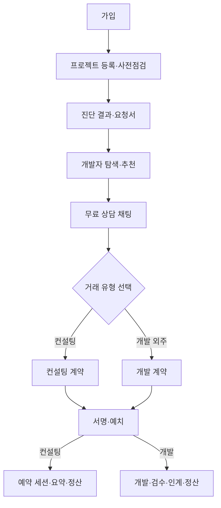

# Komit 기능명세서

## 1. 문서 목적

이 문서는 Komit이 의뢰인과 개발자에게 제공하는 기능과 이용 흐름을 정의합니다.

- 서비스 목적과 사용자 흐름: [`proposal.md`](proposal.md)
- 기한·금액·횟수와 불변식: [`RULES.md`](RULES.md)
- 구현 범위와 검증 기준: [`QA.md`](QA.md)

## 2. 서비스 개요

Komit은 바이브코딩 프로젝트를 점검하고, 의뢰 범위와 완료 기준을 구체화하여 개발자와 안전하게 거래하도록 돕는 플랫폼입니다.

## 3. 사용자

| 사용자 | 주요 활동 |
| --- | --- |
| 의뢰인 | 사전점검, 요청서 작성, 개발자 선택, 상담, 계약 확인·서명·예치, 결과 검수, 리뷰 |
| 개발자 | 프로필 관리, 상담, 계약 작성·수정·서명, 컨설팅, 개발 결과 제출, 정산받기 |
| 운영자 | 신고 확인, 정산 대사 확인, 계약 양식 관리 |

한 회원은 의뢰인과 개발자 역할을 함께 가질 수 있습니다. (`R-ACC-08`)

## 4. 회원과 프로필

- 사용자는 카카오 계정으로 로그인합니다.
- 최초 로그인 뒤 필수 약관에 동의하고 가입을 완료해야 합니다. (`R-ACC-12`, `R-ACC-13`)
- 데모 금융 기능에 사용할 회원 계좌를 가입 과정에서 준비합니다. (`R-ACC-09`, `R-ACC-10`)
- 마이페이지에서 계정, 계좌, 프로젝트, 일정과 개발자 프로필을 관리합니다.
- 개발자는 경력, 기술, 소개, 포트폴리오와 가격 정보를 공개 프로필에 등록합니다.

## 5. 사전점검과 진단

### 5.1 프로젝트 등록과 검사

- 의뢰인은 프로젝트와 현재 문제를 등록하고 사전 문진에 답합니다.
- 소스 코드는 Komit 서버에 올리지 않습니다.
- 의뢰인이 사용하던 AI 코딩 도구에서 Komit 검사 지시문을 실행합니다. (`R-SCAN-01`, `R-SCAN-02`)
- 서버에는 발견 위치, 분류, 심각도와 추가 질문을 담은 결과 파일만 업로드합니다.

### 5.2 진단 결과

- 결과 파일이 해당 진단과 검사 버전에 맞는지 확인합니다.
- 코드만으로 판단할 수 없는 사항은 추가 질문으로 보완합니다.
- 진단서는 런칭 준비도와 발견된 문제를 제공합니다.
- 재진단하면 이전 회차의 계속된 문제와 해결된 문제를 문장 지문 기능으로 연결합니다. (`R-SCAN-05`, `R-SCAN-20`)

## 6. 요청서와 QA 확인 문장

### 6.1 요청 범위 구성

- 의뢰인은 진단 결과 중 개발자에게 맡길 문제만 선택합니다.
- 선택하지 않은 문제는 요청 범위에 포함하지 않습니다.
- 진단에서 발견되지 않았지만 외주 범위에 포함하려는 요구사항은 제목, 분류와 심각도를 입력하여 직접 추가할 수 있습니다.
- 요청서 수정 화면에서는 기존 요구사항을 제외하거나 새 요구사항을 추가할 수 있습니다. 다만 계약에 이미 사용된 요구사항은 제외할 수 없습니다.
- 기존 요구사항의 제목과 설명은 요청서 수정 화면에서 편집하지 않습니다.

### 6.2 요청서 단계의 QA 확인 문장

- 사전점검 결과에는 QA 확인 문장이 자동으로 확정되어 있지 않습니다.
- 의뢰인은 요청서를 다듬으면서 요구사항별 QA 확인 문장을 직접 추가·수정·삭제할 수 있습니다.
- 의뢰인이 요청서에 포함하여 저장한 문장만 요청서의 확인 기준이 됩니다.
- 요청서에 저장한 요구사항과 QA 확인 문장은 개발 계약 초안을 만드는 초기 기준으로 사용합니다.

## 7. 개발자 탐색과 무료 상담

- 사용자는 개발자 목록과 상세 프로필, 경력, 포트폴리오와 리뷰를 확인합니다.
- 요청서에 맞는 개발자 추천과 추천 근거를 받을 수 있습니다. (`R-MATCH-05`)
- 선택한 요청서로 여러 개발자에게 무료 상담을 요청할 수 있습니다. (`R-MATCH-02`)
- 무료 상담은 `INQUIRY` 유형의 영속 채팅입니다. WebRTC·녹음·STT를 사용하지 않습니다.
- 의뢰인이 컨설팅 또는 개발 외주를 선택하면 문의방을 종료하고 해당 유형의 새 방을 만듭니다.

## 8. 계약

### 8.1 AI 최초 초안

- 새 계약 방에서 개발자가 `계약서 작성하기`를 선택합니다.
- 계약 작성 화면에 진입하면 이전 무료 상담 전체 채팅으로 최초 초안을 생성합니다.
- 서버는 의뢰인이 요청서에 저장한 요구사항을 계약 작업으로 옮기고, 요청서의 QA 확인 문장을 해당 작업의 초기 완료 조건으로 사용합니다.
- AI는 무료 상담 전체 채팅과 요청서를 함께 읽고, 상담에서 새로 합의된 QA 확인 문장을 기존 작업에 보완합니다. 요청서 밖에서 새로 합의된 작업이 있으면 해당 작업과 QA 확인 문장도 초안에 추가합니다.
- AI는 계약 전체 합의 내용을 한 번 분석하여 기존 작업의 보완 사항과 새 작업을 최초 초안에 배치합니다. (`R-CON-23`)
- 금액·일정·인계물처럼 합의가 필요한 값은 개발자가 직접 확인하고 입력합니다.

### 8.2 협의와 수정

- 개발자가 초안을 검토·수정하여 의뢰인에게 전송합니다.
- 개발자는 계약 작업과 작업별 QA 확인 문장을 추가·수정·삭제할 수 있습니다.
- 개발자는 계약을 편집하면서 각 작업의 현재 제목과 설명을 기준으로 AI 확인 문장 후보 3개를 요청하고, 필요한 후보를 해당 작업에 반영할 수 있습니다. (`R-CON-23`)
- 새로 추가한 작업도 아직 요구사항 식별자가 없어도 현재 입력한 작업 제목을 이용하여 AI 추천을 받을 수 있습니다.
- 의뢰인은 계약서를 직접 편집하지 않고 채팅으로 수정 의견을 전달합니다.
- 개발자는 의뢰인의 요청을 검토하여 수정본을 다시 전송할 수 있습니다.
- 수정 과정에서는 AI 최초 초안을 다시 생성해 사람이 편집한 내용을 덮어쓰지 않습니다.
- 어느 한쪽이라도 서명하면 계약 수정이 잠기며, 양측이 서명한 계약의 작업과 QA 확인 문장이 최종 완료 기준으로 확정됩니다. (`R-CON-02`, `R-CON-03`)

### 8.3 서명·예치·취소

- 의뢰인과 개발자는 각자 계약서에 서명합니다.
- 어느 한쪽이라도 서명하면 계약 본문을 수정할 수 없습니다. (`R-CON-02`)
- 의뢰인은 자신의 서명 뒤 계약 금액을 예치할 수 있습니다.
- 자금은 별도 Escrow가 관리합니다. (`R-PAY-05`)
- 개발자가 서명하기 전에는 의뢰인이 계약을 취소할 수 있으며, 예치금이 있으면 정책에 따라 환불합니다. (`R-CON-21`, `R-PAY-04`)

## 9. 유료 컨설팅

### 9.1 예약과 입장

- 양측 서명과 의뢰인의 예치가 끝나야 예약을 확정합니다. (`R-CON-22`)
- 입장 가능 시각은 `R-CON-08`을 따릅니다.
- 입장 요청은 녹음·전사·요약 동의를 포함하며, 양측 동의 전에는 통화를 시작하지 않습니다. (`R-CON-13`, `R-CON-17`)

### 9.2 WebRTC 세션

- 브라우저 간 WebRTC로 음성·영상과 화면을 공유합니다.
- WebSocket은 연결 협상과 상태 전달에 사용합니다.
- 직접 연결이 어려우면 시한부 TURN 자격으로 미디어를 중계합니다. (`R-CON-19`)
- 세션 채팅은 미디어와 별도로 저장합니다.

### 9.3 녹음·전사·요약

- 각 참가자는 자기 마이크 트랙을 별도로 녹음합니다. (`R-CON-14`)
- 세션 종료 뒤 녹음을 업로드하면 STT가 화자별로 전사합니다.
- AI는 전사에서 논의 내용, 결정 사항과 후속 조치를 정리하고 근거 발화 위치를 연결합니다.

### 9.4 정산

- 세션 종료, 이의 제기 기간, 지급을 막는 사유, 예치금과 수령 계좌를 확인합니다. (`R-CON-10`)
- 조건을 충족하면 Escrow를 통해 대금과 플랫폼 수수료를 정산합니다.

## 10. 개발 외주

개발 외주는 다음 순서로 진행합니다.

1. 양측 서명과 대금 예치가 끝나면 개발자가 착수합니다. 1차 작업부터 진행합니다. (`R-CON-24`)
2. 작업이 끝나면 완료 확인을 요청합니다. 통과하지 않은 일반 작업은 순서와 관계없이 요청할 수 있습니다. (`R-CON-24`)
3. 의뢰인은 계약의 QA 확인 문장에 따라 결과를 확인합니다. 일부만 통과시키면 작업이 개발자에게 돌아가고, 답이 없으면 기한 뒤 자동 통과됩니다. 돌아온 작업은 양쪽 화면에 돌아온 것으로 표시하고, 개발자에게는 다시 요청하면 기한을 새로 센다는 것을, 의뢰인에게는 자동 통과가 멈췄다는 것을 알립니다. (`R-QA-02`)
4. 모든 확인 문장을 충족한 작업을 통과 처리합니다. (`R-QA-01`)
5. 일반 작업이 모두 끝나면 개발자가 산출물에 인수시험용 URL·파일과 지급 후 해금 파일을 등록합니다. 한 산출물에 URL과 두 용도의 파일을 함께, 각각 여러 개 등록할 수 있습니다. 계약 전체에 URL 또는 시험 파일이 하나 이상, 해금 파일이 하나 이상 있어야 최종 인수시험을 요청할 수 있습니다. 요청한 뒤에는 자료를 바꿀 수 없습니다. 필요하면 계약 범위에 영향을 주지 않는 산출물 항목을 추가합니다. 화면은 등록이 닫힌 까닭을 보이고, 요청 조건 세 가지(일반 작업 통과·시험 자료·해금 파일)를 갖추기 전에는 요청 버튼을 잠급니다. (`R-QA-06`)
6. 개발자가 인계 작업의 확인을 요청하면 의뢰인이 지급 전 열람할 수 있는 URL·시험 파일로 전체 결과를 확인하고 인계 작업을 통과시킵니다. 인계 작업은 계약서마다 하나이고, 이 작업의 통과가 최종 인수시험 통과입니다. 의뢰인이 통과시키기 전에 되돌릴 수 없다는 것과 지급이 확정돼야 해금 파일을 받는다는 것을 확인창으로 한 번 더 알립니다. 무응답 자동 통과는 `R-QA-02`를 따릅니다. (`R-QA-03`, `R-QA-06`)
7. 계약 대금을 Escrow에서 전액 정산합니다. 지급액과 수수료 이체가 모두 확정되면 계약이 완료되고, 그때부터 리뷰를 남길 수 있습니다. 그 전까지 확인 탭·방 머리·진행 탭은 지급 처리 중으로 보입니다. (`R-PAY-01`)
8. 실제 지급 완료 뒤 의뢰인이 해금 파일을 내려받습니다. 시험 파일은 지급 전에도 확인할 수 있고, 개발자는 자기가 올린 파일을 언제든 받습니다. (`R-QA-06`)

## 11. 파일

- 파일 용도, 이름, 형식과 크기를 검증한 뒤 제한 시간의 업로드 URL을 발급합니다. (`R-FILE-01`~`R-FILE-03`)
- 브라우저 또는 작업자는 파일 본문을 저장소로 직접 전송합니다.
- 완료 요청에서 실제 객체의 존재, 크기와 형식을 다시 확인합니다. (`R-FILE-04`)
- 권한이 있는 사용자에게만 제한 시간의 읽기 URL을 발급합니다.
- 프로필, 경력 증빙, 서명, 녹음, 신고 증거와 인계물은 용도별 허용 형식을 따릅니다. (`R-FILE-02`)

## 12. 결제와 Escrow

- 예치는 실제 금융 거래 결과를 확인한 뒤 완료로 표시합니다. (`R-PAY-08`)
- 지급액과 수수료가 모두 확인돼야 지급 완료로 처리합니다. (`R-PAY-07`)
- 금융망 결과가 불명확하면 성공이나 실패로 추정하지 않습니다. (`R-PAY-12`)
- 같은 자금 요청을 재전송해도 한 번만 처리하도록 멱등 키와 요청 내용을 확인합니다.
- 완료된 자금 이동은 차변과 대변 금액이 같은 복식부기 원장으로 기록합니다. (`R-PAY-15`)
- 확정 원장은 수정하거나 삭제하지 않습니다. (`R-PAY-15`)
- 보관계좌 잔액과 완료 거래 원장 합계를 대사합니다. (`R-PAY-13`)

## 13. 리뷰와 신고

- 완료된 유료 거래의 의뢰인만 개발자 리뷰를 작성할 수 있습니다. (`R-REV-02`)
- 개발 실력과 설명력을 나누어 평가합니다. (`R-REV-01`)
- 개발자는 받은 리뷰에 답글을 작성할 수 있습니다. (`R-REV-03`)
- 거래 당사자는 정책에 따라 문제를 신고하고 증거 파일을 첨부할 수 있습니다. (`R-RPT-01`, `R-RPT-02`)
- Komit은 기록과 근거를 제공하며 법적 판단·조정·중재를 하지 않습니다. (`R-RPT-04`)

## 14. 보안과 개인정보

- 사용자는 자신이 당사자인 방, 계약, 세션과 파일만 이용할 수 있습니다.
- 실시간 연결은 사용자·채널·권한에 묶인 일회용 ticket을 사용합니다. (`R-RT-01`)
- 메시지 크기·전송 빈도와 무응답 연결을 제한합니다. (`R-RT-02`~`R-RT-04`)
- API key, 토큰, 계좌번호와 개인정보는 필요한 범위를 넘겨 노출하지 않습니다. (`R-LEG-02`)
- 탈퇴 뒤 데이터 처리와 재가입 정책은 `R-ACC-05`~`R-ACC-07`, `R-AUTH-05`를 따릅니다.

## 15. 관련 문서

- [`proposal.md`](proposal.md): 제품 목적과 사용자 흐름
- [`RULES.md`](RULES.md): 정책 값과 불변식
- [`QA.md`](QA.md): 구현·검증 범위와 시험 결과
- [`ai/chat-contract-draft.md`](ai/chat-contract-draft.md): 계약 초안 입출력 계약
- [`ai/transcript-evidence-contract.md`](ai/transcript-evidence-contract.md): 컨설팅 요약 근거 계약
- [`../ai/worker/docs/job-contract.md`](../ai/worker/docs/job-contract.md): Service와 AI Worker 호출 계약
